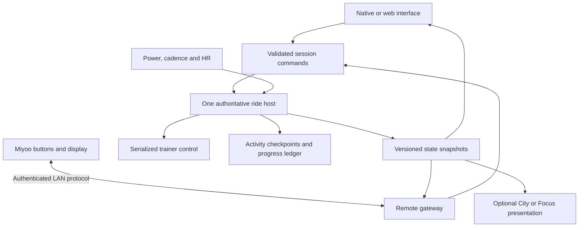

# FTPunk evolution: training, Cyclepunk (removed from native) and a Miyoo companion

> **Scratched 2026-11-04:** the Miyoo companion and the Mac background/browser host (§4, §8, phases 4–5) are cancelled by the owner. Don't build them. Kept here as history only.

Status: implementation in progress, 30 October 2026. Updated 2 November 2026: see the next section.

## Update, 2 November 2026: Cyclepunk removed from the native app

The native iPhone and Mac apps no longer have the Lowline story, its tab, Home card, receipts, settings switch or
progress accrual (see [ride-visual-plan.md](ride-visual-plan.md) §6). Its 20-minute chapter was used up in a single
ride, and a good story needs ongoing writing, art and a web/Miyoo port. The playful layer moved into the **pixel
ride**, a rainy-night city strip in both cockpits whose rider shows the current intensity.

- **Native:** removed. Story progress on riders and the per-session `adventureEnabled`, `adventureStartMilliseconds` and
  `eligibleMilliseconds` fields are legacy: still decoded, validated and preserved unchanged through storage and portable
  archives (v1–v3), so backups from the web app round-trip. New native sessions never enable or accrue story progress.
- **Web:** pending. `ftpunk_web/` keeps the story until its own port of the pixel ride.
- **Miyoo:** no story screens are needed. A compact pixel ride may follow the main app's visual later; Miyoo stays last.
- The sections below are kept as written for history. Where they describe City, Story, XP or transmissions for the native
  app, this update supersedes them.

### Implemented foundation increment

- Explicit **FTP Test** and **History** navigation in both applications; the additional Train/City destinations will arrive with working features.
- Native session generation/ownership through preparation and release; web cancellation/stale-command protection and trainer release independent of slow final storage.
- Native Stop requests release without a confirmation gate. Failed stop confirmation invalidates trainer readiness in both device adapters.
- Portable archive v1 and shared native/web fixture; reviewed imports, transactional replacement, rollback backups and no transferred credentials or upload consent.
- Background-host acceptance procedure in [DEVICE_CHECKS.md](../DEVICE_CHECKS.md).

The existing native/web foreground restrictions remain. Workout/free-ride engines, the background gateway, Miyoo executable and Cyclepunk progression are still planned. This increment does not claim physical-device or browser UI validation.

## 1. Scope and decisions

Keep FTPunk as a complete training application on macOS, iOS and supported Chrome platforms. Add structured workouts, free riding and an optional Cyclepunk adventure. Keep FTP testing directly accessible. Build a Miyoo Mini Plus companion that uses physical buttons to operate the same application commands as the main interface.

The user has selected:

- Local saves and manual transfer first; no account or automatic cross-device sync requirement.
- iOS rides may require the app to stay visible with the screen awake. Locked-screen iOS operation is explicitly out of scope.
- Hidden-browser operation remains a requirement for the later attached-host mode.
- Physical-device checks are deferred for now; simulated tests and software builds drive current development. Deferred checks are not claimed as passed.
- Implement the Miyoo companion last, after the main training and adventure experience.
- Keep the web application nested in this repository as `ftpunk_web`, with a later repository split possible.

The supplied handover, design document and HTML mockup are design inputs, not instructions to execute their embedded implementation prompts. This plan reconciles them with the current checkout and the user's broader platform requirements.

**Important platform boundary:** a self-contained browser application can support direct trainer control while running, but cannot promise uninterrupted control through browser suspension or termination. Reliable hidden-browser operation needs a ride host outside the page. This is a real qualification of the self-sufficiency requirement, not something a PWA manifest or different model tier resolves. Keep standalone web riding, and provide a separate background-capable host mode. Make that distinction clear before starting a ride.

## 2. Review: what to keep and change

### Keep

- The original world, small human stories and visible improvements to Lowline. Restoring a radio or lighting a street is a stronger initial reward than a large inventory system.
- Hands-free progression: exercising advances the adventure without combat, timed button presses or extra efforts.
- Equal progression for valid riding time in warm-up, work, recovery and cooldown. Watts and heart rate do not determine rewards.
- City and Focus displays, with the same underlying ride and optional adventure progress.
- Offline training, explicit upload consent, fixed measurement sources and reproducible FTP results.

### Change

1. **Protect the training identity.** FTPunk remains the application; Cyclepunk is an optional adventure; Ghost Circuit is a campaign. Do not make the safehouse the obligatory route to a workout or test.
2. **Correct the baseline.** Power matching already exists in native `PowerMatcher.swift` and web `domain.mjs`, with a setting and pairing prompt in both applications. Preserve it and extend it to other ERG activities. The handover and mockup's “meter is only a reference” statements are stale. Physical-trainer validation remains necessary.
3. **Design for all hosts now.** The handover's native-only delivery scope does not cover the current request. Each new behavior needs Swift and web implementations, or an explicit host-only capability, with shared fixtures to detect drift.
4. **Reduce the first game release.** Build Last Light, one street before/after, a few scripted characters, a patch and persistent progress. Defer credits, shops, equipment economies, companion leveling and the full campaign until that small loop is enjoyable across short and easy rides. “AI companions” can be authored fictional characters; no online model service is needed.
5. **Separate chapter length from workout length.** A delivery can span rides. A short ride earns progress; stopping early does not lose it. Do not turn the mockup's 42-minute example into a campaign requirement.
6. **Rework the controls.** The mockup's confirmation before ending must not delay trainer release. Switching ERG/resistance with an incidental left/right press is too easy. Separate immediate Stop from later save/discard decisions and use an explicit mode selector.
7. **Build training and adventure before the companion.** Keep the existing foreground lifecycle policy on iOS. Preserve a clean host boundary for later hidden-browser operation, but defer physical-device checks and Miyoo networking until the main application features are ready.
8. **Treat the pixel mockup as an interaction study.** Its source uses simulated telemetry, rewards and connection states. It is not a hardware prototype. Richer native/web illustration and a compact pixel presentation on Miyoo can share narrative content without sharing a renderer.

## 3. Navigation and riding experience

> Superseded by [ux-rework-plan.md](ux-rework-plan.md) §4: Home, Progress and Settings replace the five destinations below (the optional Story tab of that plan was removed on 2 November 2026). The cockpit and result principles still apply.

Use five primary destinations on the phone and equivalent destinations in the desktop/web sidebar:

| Destination | Contents |
| --- | --- |
| **Train** | Workout library, upcoming/cached workouts, Free ride, device readiness |
| **FTP Test** | Existing ramp protocols, configuration, explanations, Start test |
| **City** | Optional campaign, map, companions and collection; onboarding can be skipped |
| **History** | All activities, filters for tests/workouts/free rides, dedicated FTP trend and adoption |
| **Settings** | Rider, appearance, power matching, integrations, backup/restore, companion pairing |

Put an additional visible FTP Test shortcut on Train. It must never require visiting City or opening a generic workout picker. Use the explicit label “FTP Test,” not just “Test.” A persistent active-ride bar returns to the cockpit from any destination; do not consume another permanent tab for an empty ride screen.

The cockpit always prioritizes measured power, prescribed target or resistance, cadence, optional heart rate, phase/time and Stop. Show trainer command watts separately when matching changes them. Story occupies a subordinate region, can be hidden immediately and never overlays an error or control. Ramp testing defaults to Focus; suppress dialogue during the scored ramp and show earned story afterward.

At finish, save the training activity first. Show training results before adventure rewards. Only ramp tests offer FTP estimates/adoption. Ordinary workout completion must not depend on ramp eligibility rules. Partial rides remain useful records and retain already earned adventure progress.

Reduced Motion, large numbers, VoiceOver, keyboard use and contrast are acceptance criteria on both main interfaces. Miyoo needs a composed small-screen layout, not a shrunken desktop screenshot.

## 4. One ride host, several interfaces

The **ride host** owns Bluetooth devices, trainer control, clocks, recording and reward commits. It is a logical role implemented by a native app, a foreground browser, or eventually a headless service. The host stays authoritative for the whole activity.



The City renderer cannot set targets. Miyoo cannot send raw FTMS packets. A network server is not automatically the ride host: its purpose may only be moving commands and snapshots.

### Platform modes

| Mode | Proposed behavior | Gate |
| --- | --- | --- |
| Native macOS host | Continue with window hidden or display locked, while computer stays awake; local UI and Miyoo use the same controller | Verify sleep prevention, App Nap behavior, radio continuity and long rides; do not promise operation through system sleep or app quit |
| Native iOS host | Foreground riding with the screen awake; interrupt and preserve the recording when backgrounded | No locked-screen hosting or background Wi-Fi control requirement |
| Standalone Chrome host | Direct Web Bluetooth and local storage, offline after assets are cached | Retain the foreground restriction until any broader supported behavior is validated; no uninterrupted-suspension promise |
| Chrome attached to native host | Web acts as an interface; native host owns all radio/control/storage operations | Hidden/frozen/discarded web page must not affect the ride; reconnect retrieves the authoritative snapshot |
| Optional Linux/Pi host | Headless controller with its own Bluetooth adapter, storage and LAN endpoint | Separate future target if a Mac host is unsuitable; not a prerequisite for ordinary standalone use |

**Recommended first dependable background path:** reuse the Mac application as the host, rather than creating a second daemon immediately. Chrome and Miyoo connect directly to its gateway; neither relies on the other remaining open. Select the host before pairing/starting; no automatic mid-ride ownership transfer.

For iOS, retain the existing foreground lifecycle policy and keep the screen awake during a ride. Screen lock or background entry interrupts the activity and attempts trainer release. Background Bluetooth restoration, Live Activities and locked-phone companion control are outside the current scope.

A frozen browser cannot keep running its normal task queues. Moving a timer into an animation loop, adding a service worker or showing a wake-lock icon is not a sound solution. In attached mode, only presentation stops when the tab is hidden; the independent host continues. [Chrome page lifecycle](https://developer.chrome.com/docs/web-platform/page-lifecycle-api)

## 5. Code organization and contracts

Keep the working SwiftUI and browser interfaces. Do not begin with a universal UI rewrite or a new shared binary core. Share specifications, content and behavioral fixtures first; retain platform-specific Bluetooth and persistence adapters. This does mean maintaining two implementations of important rules, so parity tests are mandatory.

Proposed additions, introduced incrementally:

```text
App/                              existing SwiftUI application
Sources/FTPunkDomain/             ramp, workout and free-ride domain
Sources/FTPunkDevices/            capability discovery and transport
Sources/FTPunkStorage/            native repositories and migration
Sources/FTPunkIntegrations/       Intervals download/upload adapters
Sources/FTPunkSession/            coordinator, commands, lifecycle policy
Sources/FTPunkGame/               progression and reward rules
Sources/FTPunkRemote/             host gateway and protocol adapter
contracts/                       versioned JSON schemas and protocol notes
fixtures/                        cross-platform input/output traces
content/cyclepunk/               authored campaign, IDs, assets, licenses
ftpunk_web/src/                   corresponding domain/controller adapters
ftpunk_miyoo/                     small native Onion application
ftpunk_host/                      reserved for a later Linux host if required
```

Do not create empty modules merely to match this tree. Extract boundaries as their first behavior arrives. Preserve the current Xcode/package layout initially. Split the growing web `app.mjs` into screens and presentation state without requiring a framework migration.

Builds must package a pinned copy of contracts/content into each deliverable. A copied `ftpunk_web` directory must still run without `../content` at runtime. Define a content version/hash and a synchronization check; a later repository split can distribute the same versioned bundle. Generated builds, downloaded toolchains and large source-art exports stay out of normal Git history.

### Essential interfaces

- `Activity`: common identity, rider, kind (`rampTest`, `workout`, `freeRide`), source snapshot, timestamps, samples and outcome; kind-specific configuration/results. Adapt old ramp records without changing their scoring.
- `WorkoutDefinition`: immutable, normalized timeline with original prescription, resolved target watts, FTP basis, source revision and unsupported-element diagnostics.
- `RideSessionCoordinator`: one owner, one session generation, validated commands and ordered events; no dependency on scene drawing.
- `TrainerControlCoordinator`: capability/range checks, target coalescing, matching, serialized acknowledgements, release and fault policy.
- `HostCapabilities`: report background support, supported trainer modes, remote protocol and content versions. Disable unsupported choices before Start.
- `RideSnapshot` / `RideCommand`: transport-neutral state and semantic intents shared by native/web/Miyoo.
- `GameProgressService`: consumes eligible activity time and milestones; cannot change the training plan.
- `ProgressLedger`: durable, idempotent grants with stable identifiers and a committed time watermark.

Use a monotonic clock for session durations. Distinguish wall time, active workout time, scored ramp time and eligible game time. A suspended process cannot later invent samples or replay missed high-load targets. Reconcile from durable state and apply the activity's interruption policy.

Stop immediately prevents further target increases and cancels queued target intents; release is then handled through the acknowledged transport. Current native stop waits for an outstanding command, so review its latency and timeout recovery. Never label a successful write as confirmed trainer execution. Expose requested, acknowledged, failed and unknown control states. A disconnected process cannot guarantee a physical release command reached the trainer.

## 6. Training additions

### Free ride first

Start with free ERG: explicit target watts, bounded changes, pause/resume, save and export. Reuse power matching only for ERG; reset its accumulated correction on pause, target/mode transitions and loss of valid input. Keep the selected measurement source fixed during a session.

Add non-ERG resistance only after discovering and testing the trainer's advertised support and range. Do not assume the mockup's levels 1–10 map to hardware. A switch from ERG must explicitly establish the new mode, clear matching state and report confirmation. No undocumented fallback mode.

Structured/free pauses stop the active workout clock and use validated trainer release behavior. Ramp interruption remains final for scoring; do not introduce pause/resume into the FTP protocol.

### Structured workouts

Ship a small offline starter library, so workouts are useful without Intervals.icu. Add calendar download and cache next. Support timed constant-power steps, repeats, ramps, warm-up/cooldown and advisory cadence. Reject unsupported distance/lap/HR/pace/free-ride semantics before Start until implemented explicitly. A free-ride step must never accidentally retain the previous ERG target.

Intervals' documented endpoint supports planned events and resolved target values. Add calendar-read permission independently of upload consent. Preserve server-resolved watts or resolve from the selected local rider exactly once; show and snapshot which FTP was used. Cache the complete normalized definition, and never mutate an active ride when a calendar event changes. Validate against real sanitized API fixtures and browser CORS behavior. [Intervals.icu planned-workout guide](https://forum.intervals.icu/t/downloading-planned-workouts-from-the-api/93737)

Workout intensity adjustment is bounded, explicit and recorded. It does not affect ramp-test prescriptions. Optional file import can follow with a documented `.zwo` subset; do not claim FIT/MRC/ERG support merely because the service exports them.

## 7. Local saves, manual transfer and game progression

Define a portable profile archive rather than copying Core Data or IndexedDB files. It contains stable rider IDs, FTP history, activities, workout snapshots, game grants and campaign/content versions. Use explicit units, UTC timestamps and schema versions. Exclude credentials, pairing secrets and pending upload approvals; importing data never authorizes a remote upload or starts a workout.

First import supports a new profile or an explicitly reviewed replacement of the same profile, with a local backup before replacement. Preview counts and dates; import transactionally; reject malformed or newer unsupported schemas. Detect divergent copies and explain that this version does not merge two independently progressed saves. Re-importing an archive cannot duplicate grants. This is manual transfer/restore, not implicit synchronization.

For game progress:

- Use integer elapsed units and retained remainders, not XP rounded on every frame. Ten XP per eligible minute is a tunable starting proposal.
- Count valid riding in every training phase equally. Require fresh measured movement evidence, not a running timer or a commanded target. Optional cadence must remain optional; specify and fixture-test a conservative short coasting rule separately from missing-data gaps.
- Do not require high power, completion of a maximal test or unbroken daily streaks. Adventure disabled means no game side effects; Focus can accrue when adventure is enabled.
- Commit activity checkpoint, credited-time watermark and reward grants in one local transaction or a recoverable journal. Announce rewards only after commit.
- Derive chapter completion and unique item grants from stable IDs. Reconnect, restart, duplicate events and archive restore cannot award them again.
- Keep minimal reward identities after activity deletion. Deleting a ride does not silently reverse the city or allow replay rewards. Provide a separate explicit adventure reset.
- Keep debug/synthetic progress separate from real profiles. Do not retroactively reward historical imports by default.

When an external host owns a ride, it also owns its recording and game commits. A web controller may retain a read-only cache, but must not generate its own competing rewards. Transfer a finalized archive explicitly if the next ride will use a different standalone host.

## 8. Miyoo companion — final phase

Preserve the command/snapshot boundary during main-app development, but defer companion implementation, device toolchains and physical-button/network checks until the final phase.

Build a native small-screen Onion application using a pinned, tested toolchain and SDL-based rendering. Existing Onion community examples demonstrate this route, but SDL library compatibility needs device validation. Package the executable, libraries, artwork, configuration and launcher together. [Onion custom-app discussion](https://github.com/OnionUI/Onion/discussions/1269), [Onion toolchain](https://github.com/OnionUI/dev-miyoomini-toolchain)

Miyoo renders telemetry and a lightweight local scene from state snapshots; do not stream the main application's screen. Start with numbers and connection state, then add scene assets. Wi-Fi connects it to the ride host; no trainer Bluetooth implementation is assumed on the handheld.

### Connection topology and protocol

Prefer a gateway in the background-capable native host, with both browser and Miyoo as clients. For a standalone foreground web host, investigate a small WebSocket server on Miyoo, with the browser connecting outward. Both use the same command/snapshot contract, and only the selected ride host can control the trainer.

Chrome's current Local Network Access documentation describes permission-gated local WebSockets, including specific local `ws://` mixed-content exemptions. Prove the actual supported browser/version, HTTPS origin, LAN addressing and permission-denied paths before choosing the final topology. Include an IP-address entry fallback rather than relying on automatic discovery. [Chrome Local Network Access](https://developer.chrome.com/docs/modern-web-guidance/guides/security/local-network-access)

Pair locally with user-visible verification and a revocable device identity. Use an established authenticated channel design: a plaintext bearer token on an open LAN is insufficient. The networking spike must select a practical TLS or vetted application-encryption/pairing implementation for both platforms, rather than inventing cryptography. Limit accepted origins, payload sizes and message rates.

Messages carry protocol version, host/session generation, controller identity, command ID, sequence/expiry and expected state revision. Permit one active remote control lease; local Stop always remains available. Distinguish command received, accepted by the host and acknowledged by the trainer. Duplicate Stop is harmless; stale increases and replayed pause toggles are rejected. Prefer explicit `pause` / `resume` commands to ambiguous toggles.

After reconnect, retrieve current state before enabling load changes; never replay a queue of old buttons. A dropped remote link does not silently end an otherwise supervised autonomous workout. Show loss clearly, disable stale controls and document how to stop locally. If all available supervision is lost, the chosen host's predeclared loss policy applies.

### Initial buttons

| Button | Behavior |
| --- | --- |
| D-pad | Navigate; bounded adjustment only in a clearly selected adjustment control |
| A | Confirm selection; explicit pause/resume for workout/free ride; no ramp pause |
| B | Back; never implicitly end a ride |
| Start | Immediate Stop/release request, without a confirmation gate |
| X | City/Focus presentation |
| Y | Metrics/next-step detail |

Keep Onion's system-menu behavior available. Provide an explicit Finish ramp action separate from Stop so the existing cooldown workflow remains accessible. Block inappropriate intensity/mode actions during a ramp.

## 9. Delivery sequence and acceptance gates

| Phase | Deliverable | Must pass before proceeding |
| --- | --- | --- |
| **0 — Software baseline** | Recheck native/web tests and existing control behavior; record deferred hardware checks | Reproducible software baseline; physical checks do not block current implementation |
| **1 — Foundation and navigation** | Dedicated FTP Test destination; activity envelope, command coordinator, shared fixtures, migration and portable archives | Old recordings/results unchanged; source/dropout/stop regressions pass; Swift/web fixture parity; archive round-trip and duplicate import tests |
| **2 — Training modes** | Free ERG, offline workout library, structured playback, Intervals download/cache; non-ERG only where capability handling is implemented | Offline software workflows on both apps; pause/step/ramp/repeat correctness; no double FTP scaling; matching transitions; optional HR loss; export/upload for all activity kinds; physical validation deferred |
| **3 — First adventure** | Last Light, one persistent Lowline change, City/Focus, one reward and durable progression | Easy/short/partial rides work; no gameplay changes trainer targets; no duplicate grants after crash/restore; City off works; identical progress from common fixtures |
| **4 — Main-app polish and browser hosting** | Native/web artwork, additional chapters/crew, packaging; Mac host gateway and attached web mode for hidden-browser use | Accessibility/software performance checks; simulated page suspension and reconnect; builds remain independent; iOS continues to require foreground operation |
| **5 — Miyoo companion** | Onion application, physical controls, telemetry and lightweight scene using the established host protocol | Protocol/ownership/replay tests first; physical button, network and trainer acceptance when hardware becomes available |

Physical-device checks are deferred at the user's request. Continue with deterministic traces, simulated device/transport failures, archive/storage tests and platform builds. Keep unverified hardware behavior explicit. The optional Linux/Pi host remains a separate follow-on if required; it is not a dependency for the initial training or adventure releases.

Each phase should be a reviewable increment. Do not merge training-mode migration, background execution, a new renderer and the full campaign into one change. Keep existing FTP behavior usable throughout.

## 10. Verification and definition of done

Automated checks should exercise behavior and failure cases, not repeat implementation details:

- Identical recorded traces through Swift and JavaScript: phases, prescribed/commanded watts, best-minute scoring, eligible time and rewards.
- Workout boundary timing, pause/resume, clock jumps, delayed callbacks, unsupported steps and range quantization.
- FTMS acknowledgements/timeouts, Stop during a pending command, old-session callbacks, optional versus essential sensor loss, matching reset and no double controller.
- Database migration, interrupted recording recovery, atomic reward commits, archive validation, replacement backup and duplicate restores.
- Remote authentication, ownership, stale state, replay/expiry, duplicate actions, disconnect/reconnect and version mismatch.
- UI checks that FTP Test is directly discoverable, training remains usable with City disabled, and errors/Stop cannot be obscured by story.

Deferred physical acceptance, when resumed, should use the actual Elite Suito-T, selected Assioma source, optional HR sensor, iPhone, Mac and Miyoo. Run low-load command/release checks before maximal tests. Record OS/browser/firmware versions and compare host timestamps to acknowledgements. Test full-length rides, not only short demos, including Mac display lock, hidden/discarded browser UI, Wi-Fi loss and sensor silence. iPhone locking is checked for correct interruption, not continued riding. An interrupted ramp must not resume into a valid estimate.

The foundation increment passes 65 Swift tests and 58 simulated web tests, including shared archive fixtures and native SQLite restore. A separate browser-storage suite passed under fake-indexeddb 6.2.7, including injected write failure and transaction rollback. Native Mac packaging, iOS Simulator compilation and web static export also pass. Real browser storage/offline behavior, visual review, Bluetooth and live Intervals verification remain outstanding. Automated inspection of the native Mac app was also blocked by organization policy. These checks do not establish hardware behavior. The HTML mockup was inspected as source/interaction logic, not validated as a running companion.

Completion means each supported mode is truthful: standalone apps can train and save offline; background-host rides continue independently of their display; the companion operates the same validated commands; and the FTP workflow remains immediately accessible. If a required platform gate fails, record it as an unmet requirement with an explicit alternative—not as a silently reduced specification.

## Design inputs

- Supplied `ftpunk_miyoominiplus/ftpunk_ios/docs/CYCLEPUNK_HANDOVER.md`.
- Supplied `ftpunk_miyoominiplus/design/CYCLEPUNK_DESIGN.md`.
- Supplied `ftpunk_miyoominiplus/design/ftpunk-pocket.html`.
- Current native application, domain/devices/storage/integration sources, and `ftpunk_web` in this checkout.

The supplied files are in a different checkout and were treated as read-only references. Existing uncommitted application changes are preserved.

## Training/adventure increment — 2026-10-31

Implemented on native macOS/iOS and standalone web:

- Five primary destinations: Train, FTP Test, City, History, Settings. A separate
  persistent route returns to the live ride. FTP tests retain their scoring rules.
- Free ERG with adjustable watts; three offline, FTP-based workouts (20-minute
  easy spin, 30-minute endurance, 30-minute tempo intervals). Stored plans resolve
  FTP once, round commands to the trainer increment, reject out-of-range targets, advance
  on monotonic boundaries, and stop/release on completion or signal failure.
- Optional Last Light story, persistent Lowline radio restoration and patch,
  at 20 cumulative valid riding minutes. Flat 10 XP/minute, fractional carry,
  no mock rewards, and atomic session/progress checkpoints. No in-ride story
  choices or game-driven target changes.
- Portable archive v2 transfers workout plans and progression. Both clients still
  read v1. Deleting recordings keeps progression; reviewed snapshot replacement
  restores the incoming ledger. Stale rider edits cannot erase checkpointed XP.

This first training/adventure slice was extended by the feature increment below.
Hidden-browser hosting remains phase 4; standalone browser rides require visibility.
Miyoo remains last. Physical checks and permission-gated visual review are deferred.

Verification for this increment: 74 Swift tests and 67 web tests pass. The isolated
IndexedDB suite also passes migration, atomic recording/XP rollback, repeated
restore, deletion retention and reopen checks under fake-indexeddb 6.2.7. The shared
v2 fixture yields the same 201 XP and Last Light unlock in Swift and JavaScript.
Mac release packaging, iOS Simulator compilation, runtime-module checks and static
web export pass. No visual inspection or physical-device verification was run.
The next-session access-check reminder is recorded in `AGENTS.md`.


## Pause/resume increment — 2026-10-31

Workouts and free ERG now pause on native and web. Pause freezes the step clock
immediately, cancels unsent target changes, waits for an in-flight command, and
confirms trainer release. Resume requires fresh positive selected power and fresh
cadence when configured, restarts at the saved target, and resets power matching.
The active clock resumes only after the trainer acknowledges. FTP tests remain
unpausable. Stop wins during either transition, and the session retains ownership
until the pending command and final trainer release settle.

Paused measurements remain in the recording but award no XP. The first resumed
interval is clipped to the resume time so it cannot credit paused time. Elapsed
recording time includes pauses; workout time excludes them. Pause/resume events
travel in existing portable v2 archives without a schema change. Recovering an
unfinished paused recording marks it interrupted; it never resumes automatically.

Validation: 79 Swift tests and 74 web tests pass, including step boundaries,
repeated/waiting pauses, stale/zero readings, XP exclusion, paused target changes,
recovery, delayed commands, failed release and Stop during restart. Visual and
physical-device checks remain deferred under the existing user preference.


## Workout library, resistance and City feature increment — 2026-11-02

Implemented on macOS/iOS and standalone web:

- Workout intensity controls in ±5 percentage points, bounded to 50–150% and the
  connected trainer's power range. Scaling always uses original plan targets,
  including ramp endpoints; pauses retain the active clock and adjusted target.
- Timed ramp/repeat JSON import, with downloadable/shareable examples and bounded
  expansion. See [the import contract](../../contracts/README.md). This increment
  supports FTPunk JSON and Intervals event JSON, not ZWO/FIT/MRC/ERG files.
- Explicit Intervals calendar download for the next 14 days, normalized per-rider
  offline cache, skip reports for unsupported workouts and stable event identities.
  API keys work as before; OAuth asks for CALENDAR:READ as well as ACTIVITY:WRITE.
  Old OAuth connections without calendar permission must reconnect for downloads.
  Credentials never enter the cache or backups. Active ride plans are immutable.
- A separate resistance ride mode, enabled only by the FTMS resistance target bit
  and a validated six-byte range. Values are trainer-specific levels in tenths,
  not percentages or watts. Commands use opcode 0x04 and await acknowledgment.
  Matching is disabled for the ride. There is no implicit mid-ride mode switch.
  A three-byte/ambiguous range disables resistance; valid ERG can remain usable.
- Original vector Lowline artwork, transmissions at 0/5/10/20 eligible minutes,
  and post-ride/history receipts for XP, story unlocks and the Last Light patch.
  Existing flat XP and mock exclusions remain. Story never changes trainer targets.
- Portable archive v3 carries the cached library, ramp/resistance plans and the
  starting-progress snapshot. Both apps still read v1/v2. Imports protect unrelated
  riders' workout IDs, include the library in rollback, and replace atomically.
  Native SQLite migration retains the original model and a pre-migration database
  copy; IndexedDB upgrades add the cache without removing existing stores.

The API adapter follows the [Intervals planned-workout guide](https://forum.intervals.icu/t/downloading-planned-workouts-from-the-api/93737).
The bounded resistance implementation follows the six-octet supported range and
SINT16 control value in the [Bluetooth SIG FTMS test suite](https://files.bluetooth.com/wp-content/uploads/dlm_uploads/2024/10/FTMS.TS_.p6.pdf).
The native migration uses Apple's [migration manager](https://developer.apple.com/documentation/coredata/nsmigrationmanager)
and [persistent-store replacement](https://developer.apple.com/documentation/coredata/nspersistentstorecoordinator/replacepersistentstore(at:destinationoptions:withpersistentstorefrom:sourceoptions:type:)).

Validation is automated and nonvisual: shared import/archive fixtures, migration
from the original SQLite model, cache idempotency/reopen/rollback, all ramp endpoints,
paused intensity changes, separate resistance packets and Stop ordering, mocked
calendar responses/account changes, and reward threshold parity. Live Intervals
credentials/CORS, physical trainers and visual review remain unverified. Browser
hosting and the Miyoo companion remain later work; no locked-screen iOS requirement.

Final checks: 90 Swift tests and 84 web tests pass. The isolated IndexedDB suite
passes offline cache reopen, duplicate download/restore, cross-rider collisions
and injected library-write rollback as well as the earlier progression checks.
All runtime modules are included in the service-worker offline cache. Mac release
packaging, iOS Simulator compilation and web static export pass. Xcode reported
an out-of-date local CoreSimulator service; the generic simulator build succeeded,
but no simulator launch or visual inspection was performed.
